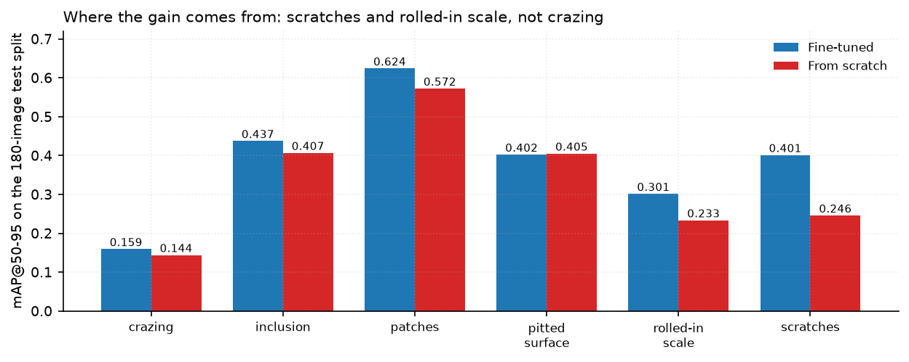
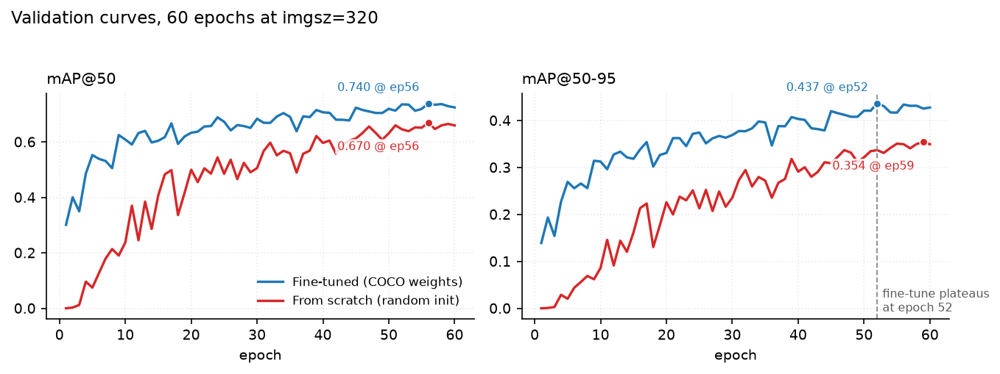
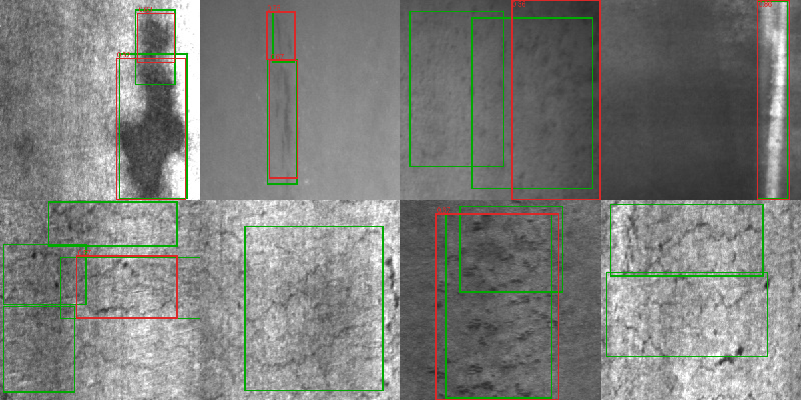
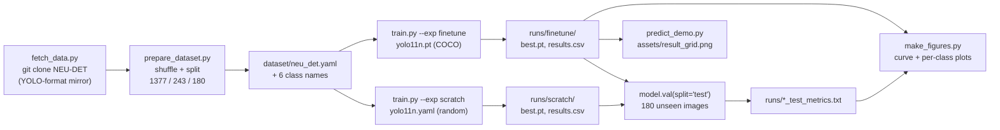

# Steel Surface Defect Detection — YOLO11 Fine-tuning vs. Training from Scratch

A small, fully reproducible object-detection study on **NEU-DET**: six classes of hot-rolled
steel surface defects, 1 800 grayscale images, one consumer GPU. The repository does not just
report a score — it runs the **same architecture and the same hyper-parameters twice**, once
from COCO-pretrained weights and once from random initialisation, and then measures what the
pretrained weights are actually worth.

**English** · [简体中文](README.zh-CN.md)


---

## Contents

- [Results](#results)
- [Per-class breakdown](#per-class-breakdown)
- [What the numbers actually say](#what-the-numbers-actually-say)
- [Qualitative check](#qualitative-check)
- [Quick start](#quick-start)
- [Pipeline](#pipeline)
- [Repository layout](#repository-layout)
- [Dataset](#dataset)
- [Experiment settings](#experiment-settings)
- [Notes on reproducibility](#notes-on-reproducibility)
- [Limitations](#limitations)
- [Roadmap](#roadmap)
- [Acknowledgements](#acknowledgements)
- [License](#license)
- [FAQ](#faq)

---

## Results

Measured on a **held-out test split of 180 images / 446 instances** that is never touched during
training and never used to pick a checkpoint:

| Experiment | mAP@50 | mAP@50-95 | Precision | Recall | Best epoch (on val) |
|---|---|---|---|---|---|
| **Fine-tuned** YOLO11n (COCO weights) | **0.7213** | **0.3876** | 0.6120 | **0.6924** | 52 |
| **From scratch** (same model, random init) | 0.6760 | 0.3345 | **0.6695** | 0.5942 | 59 |
| Δ (fine-tuned − scratch) | **+0.0453** | **+0.0531** | −0.0575 | **+0.0982** | — |

Both runs: 60 epochs, `imgsz=320`, `batch=16`, `seed=42`, identical augmentation pipeline.
The only difference is the initial weights.

Training cost, read straight from `runs/*/results.csv`:

| Experiment | 60 epochs wall-clock | median epoch | first epoch¹ | model size |
|---|---|---|---|---|
| Fine-tuned | 566 s (9 min 26 s) | 8.7 s | 41.9 s | 2.62 M params |
| From scratch | 573 s (9 min 33 s) | 9.1 s | 29.9 s | 2.62 M params |

¹ The first epoch pays for filling the RAM cache and CUDA autotuning, so it is not representative.

Hardware: single **RTX 3050 Laptop, 4 GB**, `torch 2.6.0+cu124`, `ultralytics 8.4.208`.

---

## Per-class breakdown

mAP@50-95 on the test split:

| Class | Fine-tuned | From scratch | Δ | relative |
|---|---:|---:|---:|---:|
| crazing (craze cracks) | 0.1593 | 0.1440 | +0.0153 | +10.6 % |
| inclusion | 0.4373 | 0.4067 | +0.0306 | +7.5 % |
| patches | 0.6240 | 0.5723 | +0.0517 | +9.0 % |
| pitted_surface | 0.4024 | 0.4050 | −0.0026 | −0.6 % |
| rolled-in_scale | 0.3014 | 0.2334 | +0.0680 | +29.1 % |
| scratches | 0.4012 | 0.2457 | +0.1555 | +63.3 % |



The +0.053 macro gain is **not spread evenly**. Two thirds of it comes from a single class:
`scratches` improves by 0.156 (63 % relative), `rolled-in_scale` by 0.068. `pitted_surface` is
flat, and `crazing` — the worst class in both settings — barely moves. A mean is a poor summary
of this table; the interesting question is *why* the gain concentrates where it does.

---

## What the numbers actually say

**1. Pretraining buys convergence speed more than it buys accuracy.**
The fine-tuned run reaches its best checkpoint at epoch 52 and then drifts sideways; the
from-scratch run is still climbing at epoch 59, when the budget runs out. The gap is real but it
is partly a statement about *time*, not a ceiling: given another 60 epochs the scratch model
would likely recover part of it. What pretraining clearly does is end the search sooner — on a
4 GB laptop GPU that is the difference between a coffee and an afternoon.



**2. The gain is in recall, and it is paid for with precision.**
Recall 0.594 → 0.692 (+9.8 points) while precision 0.669 → 0.612 (−5.7 points). The pretrained
model is more willing to fire on weak evidence, so it catches thin scratches it used to miss and
raises more false positives at the default `conf=0.25`. This is a trade-off to be resolved by
the cost of a missed defect versus the cost of a false alarm — not by picking whichever run has
the prettier mAP. In a production line those two costs are rarely equal.

**3. Input size should come from the data, not from a habit.**
NEU-DET images are 200 × 200. Upsampling them to the YOLO default of 640 adds no information —
it interpolates pixels that were never there — while multiplying the compute per epoch by roughly
the square of the scale factor. Every run here uses `imgsz=320`, which is already an upscale from
200, and a full 60-epoch run finishes in under 10 minutes. The same reasoning applies to any
dataset that arrives at a fixed small resolution; check the source dimensions before copying a
config from a COCO tutorial.

**4. The weak classes are a data problem, not a patience problem.**
`crazing` sits at 0.159 in both settings. The defects are thin, low-contrast and their boundaries
are genuinely ambiguous: shift the box by a few pixels and IoU collapses below the matching
threshold, regardless of how confident the prediction is. `crazing` and `scratches` also share a
near-identical texture, which is visible as cross-confusion in
[`runs/finetune_test/confusion_matrix_normalized.png`](runs/finetune_test/confusion_matrix_normalized.png).
Class imbalance amplifies it: in the training split `inclusion` has **799** instances while
`pitted_surface` has **322** (2.5×).

**5. A val→test drop is expected; quantify it before reading tea leaves.**
At its selected checkpoint (epoch 52) the fine-tuned model scores 0.7357 / 0.4368 (mAP@50 /
@50-95) on val but 0.7213 / 0.3876 on test, because the checkpoint was selected *on val*. The
scratch model, at its own selected epoch 59, scores 0.6650 / 0.3543 on val but 0.6760 / 0.3345 on
test — its test mAP@50 is slightly **above** val, which is noise, not a miracle. With 46 test
instances of `pitted_surface`, a single mis-ranked box moves that class by ≈1/46 ≈ 0.02, so
differences below 2–3 points should not be treated as signal.

---

## Qualitative check



Green = annotated ground truth, red = prediction (number = confidence), sampled from the test
split with `seed=7`. Large regions (`patches`, `inclusion`) are localised tightly. Two failure
modes are visible in this small sample: textured areas that receive **no box at all**, and
imprecise boundaries on crooked, low-contrast regions — exactly the `crazing` case discussed
above.

---

## Quick start

Requires a CUDA-capable GPU for the timings above; everything also runs on CPU with
`--device cpu` (expect roughly an order of magnitude slower).

```bash
# 1. clone
git clone https://github.com/wushaw1102/steel-surface-defect-detection.git
cd steel-surface-defect-detection

# 2. virtual environment
python -m venv .venv
.venv/Scripts/activate           # Windows;  source .venv/bin/activate on Linux/macOS

# 3. PyTorch with the CUDA build that matches your driver (cu124 shown here)
pip install torch torchvision --index-url https://download.pytorch.org/whl/cu124

# 4. ultralytics (and matplotlib / pillow, used by the scripts)
pip install ultralytics matplotlib pillow

# 5. fetch the dataset (~145 MB, not stored in this repository)
python scripts/fetch_data.py

# 6. build the train/val/test split and write dataset/neu_det.yaml
python scripts/prepare_dataset.py

# 7. run both experiments (about 10 minutes each on a 3050 Laptop)
python scripts/train.py --exp finetune
python scripts/train.py --exp scratch

# 8. evaluate any checkpoint on the test split, on its own
python -c "from ultralytics import YOLO; print(YOLO('runs/finetune/weights/best.pt').val(data='dataset/neu_det.yaml', split='test', imgsz=320))"

# 9. regenerate the figures in this README
python scripts/predict_demo.py        # assets/result_grid.png
python scripts/make_figures.py        # assets/curve_compare.png, assets/per_class_map.png
```

Steps 5–7 are idempotent: `fetch_data.py` skips the clone if `neu_src/` already exists, and
`prepare_dataset.py` wipes and rebuilds `dataset/neu_det/` from scratch on every run.

No checkpoint? The fine-tuned `best.pt` (5.2 MB) is attached to
[release v1.0.0](https://github.com/wushaw1102/steel-surface-defect-detection/releases/tag/v1.0.0).
Drop it into `runs/finetune/weights/`, or point the visualiser at it directly:

```bash
# either fetch it yourself
curl -L -o best.pt https://github.com/wushaw1102/steel-surface-defect-detection/releases/download/v1.0.0/best.pt
python scripts/predict_demo.py --weights best.pt
```

---

## Pipeline



The train/val/test split is performed once, in `prepare_dataset.py`, with `seed=42`, and the
resulting files are copied to disk — so both experiments see byte-identical splits.

---

## Repository layout

```
scripts/
  fetch_data.py        shallow-clone the source dataset into neu_src/
  prepare_dataset.py   deterministic 3-way split, writes dataset/neu_det.yaml + class counts
  train.py             fine-tune or train-from-scratch, then evaluate on test
  predict_demo.py      GT (green) vs prediction (red) grid on 8 test images
  make_figures.py      rebuild assets/curve_compare.png and assets/per_class_map.png
dataset/               generated by prepare_dataset.py, git-ignored
runs/
  finetune/            results.csv, results.png, PR/F1 curves, confusion matrices, weights
  scratch/             same, for the from-scratch control
  finetune_test/       PR curve + confusion matrix measured on the test split
  scratch_test/
  *_test_metrics.txt   the numbers quoted in the tables above
assets/                figures embedded in this README
```

---

## Dataset

**NEU-DET** (Northeastern University surface defect database): hot-rolled steel strip, six
classes — `crazing`, `inclusion`, `patches`, `pitted_surface`, `rolled-in_scale`, `scratches`.
Grayscale, 200 × 200, 1 800 images. This repository uses the YOLO-format mirror
[`Marfbin/NEU-DET-with-yolov8`](https://github.com/Marfbin/NEU-DET-with-yolov8) so that no
conversion step is hidden from the reader. The images are **not redistributed here**.

| Split | Images | Instances | crazing | inclusion | patches | pitted_surface | rolled-in_scale | scratches |
|---|---:|---:|---:|---:|---:|---:|---:|---:|
| train | 1 377 | 3 180 | 515 | 799 | 650 | 322 | 480 | 414 |
| val | 243 | 563 | 95 | 123 | 132 | 64 | 79 | 70 |
| test | 180 | 446 | 79 | 89 | 99 | 46 | 69 | 64 |

`val` is carved out of the source `train` split (15 %, `seed=42`); the source `test` split is kept
intact and is used only for the final numbers.

---

## Experiment settings

| Item | Value |
|---|---|
| Model | YOLO11n, 2.62 M parameters |
| Initialisation | COCO pretrained (`yolo11n.pt`) vs. random (`yolo11n.yaml`) |
| Input size | 320 × 320 (source images are 200 × 200) |
| Batch / epochs | 16 / 60, `patience=15` (early stopping never triggered) |
| Optimiser | Ultralytics `optimizer=auto` → SGD with warm-up, `lr0=0.01` |
| Augmentation | Ultralytics defaults (mosaic, HSV, flips, scale) |
| Precision | AMP (fp16) |
| Seed | 42 |
| Data loading | `cache="ram"`, `workers=2` |
| Checkpoint selection | best val mAP@50-95 |

The complete resolved configuration of each run is committed as `runs/<exp>/args.yaml`, so the
tables in this README can be traced back to an actual artefact rather than to memory.

---

## Notes on reproducibility

Four things that cost real time and are worth knowing before you re-run this:

**Split before you tune, not after.** `val` is used for checkpoint selection and early stopping;
`test` is touched exactly once, at the end. If you find yourself adjusting hyper-parameters
against `test`, the table above stops meaning anything.

**`dataset/neu_det.yaml` contains an absolute path.** `prepare_dataset.py` writes
`path: <absolute path to dataset/neu_det>` because Ultralytics resolves dataset roots that way.
The file is generated locally and git-ignored — never commit it, or everyone inherits your
directory layout.

**Ultralytics needs a fresh `neu_det.yaml` if you move the project.** The `path` key is baked in
at generation time; re-run `prepare_dataset.py` after relocating the repository.

**Windows + `workers>0` is slow to start.** Each worker re-imports torch; with `cache="ram"` and
only 1 377 training images, the loader is not the bottleneck, so 2 workers is a reasonable
compromise between startup cost and throughput. Raise it only if you measure a benefit.

---

## Limitations

- **Single dataset, single imaging condition.** 200 × 200 laboratory greyscale crops do not
  describe a production line: lighting, scale, motion blur and class priors will all differ.
  The absolute numbers here should not be quoted as an industrial benchmark.
- **One seed per configuration.** No k-fold cross-validation, so treat differences of a couple of
  points as noise (see point 5 above).
- **No architecture search.** Only YOLO11n was tried; a larger variant may well close the gap to
  the from-scratch run purely by capacity, which would change the interpretation of the ablation.
- **Boxes only.** No instance segmentation, no defect-area regression, no tracking across frames.
- **`conf=0.25` everywhere.** The precision/recall operating point was not tuned per class, which
  the per-class table suggests it should be.

---

## Roadmap

- [ ] 3-seed runs with mean ± std to attach error bars to the ablation
- [ ] per-class confidence thresholds swept on `val`, reported on `test`
- [ ] `yolo11s` / `yolo11m` at matched epoch budget, to separate "pretraining helps" from
      "capacity helps"
- [ ] export to ONNX and measure CPU latency, since the target is a line-side box
- [ ] copy-paste augmentation for the rare `pitted_surface` class

---

## Acknowledgements

- Dataset: **NEU-DET**, K. Song and Y. Yan, *A noise robust method based on completed local
  binary patterns for hot-rolled steel strip surface defects*, Applied Surface Science, 2013.
- YOLO-format mirror: [`Marfbin/NEU-DET-with-yolov8`](https://github.com/Marfbin/NEU-DET-with-yolov8).
- Detector: [Ultralytics YOLO11](https://github.com/ultralytics/ultralytics).

## License

Code in this repository is released under the [MIT License](LICENSE). The NEU-DET images and
annotations remain the property of their original authors and are downloaded at setup time, not
redistributed here.

---

## FAQ

**Is 0.72 mAP@50 good for NEU-DET?**
It is in the normal range for a nano-scale detector at 320 px on this dataset. Published numbers
are not directly comparable unless the split, input size and evaluation protocol match — which
is precisely why the splits and the raw `results.csv` files are committed here.

**Why not just report the fine-tuned model?**
Because "fine-tuning helped" is only interesting if you know *how much* and *where*. The
from-scratch control costs ten minutes and turns a claim into a measurement — and the per-class
table shows the gain is concentrated in two classes, which a single number would have hidden.

**Can I train on my own six-class dataset?**
Yes — replace `CLASSES` in `scripts/prepare_dataset.py` and point `fetch_data.py` (or your own
copy step) at your data in YOLO format. Nothing else in the pipeline is NEU-DET specific.

**Why is `patience=15` in the config if it never fired?**
It is a guard for larger budgets. With 60 epochs and the scratch run still improving at epoch 59,
it would have mattered the moment the schedule was extended.
