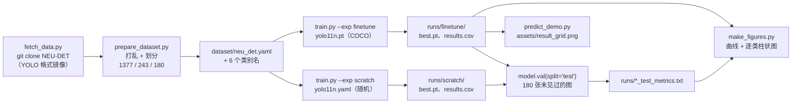

# 钢材表面缺陷检测 —— YOLO11 微调 vs. 从零训练

在 **NEU-DET** 上做的一个小而完整的检测实验：六类热轧钢材表面缺陷、1800 张灰度图、一块消费级显卡。
这个仓库不只报一个分数——它把**同一个结构、同一套超参跑两遍**，一遍从 COCO 预训练权重出发，
一遍从随机初始化出发，然后量化预训练权重到底值多少。

[English](README.md) · **简体中文**


---

## 目录

- [实验结果](#实验结果)
- [逐类别拆解](#逐类别拆解)
- [这几个数字到底说明了什么](#这几个数字到底说明了什么)
- [定性检查](#定性检查)
- [快速开始](#快速开始)
- [流程](#流程)
- [仓库结构](#仓库结构)
- [数据集](#数据集)
- [实验设置](#实验设置)
- [关于复现](#关于复现)
- [局限](#局限)
- [后续计划](#后续计划)
- [致谢](#致谢)
- [许可](#许可)
- [FAQ](#faq)

---

## 实验结果

在 **180 张图 / 446 个实例的独立测试集**上评测——该划分既不参与训练，也不用于挑选 checkpoint：

| 实验 | mAP@50 | mAP@50-95 | Precision | Recall | 最佳 epoch（按 val） |
|---|---|---|---|---|---|
| **预训练微调** YOLO11n（COCO 权重） | **0.7213** | **0.3876** | 0.6120 | **0.6924** | 52 |
| **从零训练**（同结构，随机初始化） | 0.6760 | 0.3345 | **0.6695** | 0.5942 | 59 |
| Δ（微调 − 从零） | **+0.0453** | **+0.0531** | −0.0575 | **+0.0982** | — |

两组实验完全一致：60 epoch、`imgsz=320`、`batch=16`、`seed=42`、同样的增强流程。
唯一变量就是初始权重。

训练开销，直接取自 `runs/*/results.csv`：

| 实验 | 60 epoch 实际耗时 | epoch 中位数 | 第 1 个 epoch¹ | 模型规模 |
|---|---|---|---|---|
| 微调 | 566 s（9 分 26 秒） | 8.7 s | 41.9 s | 2.62 M 参数 |
| 从零 | 573 s（9 分 33 秒） | 9.1 s | 29.9 s | 2.62 M 参数 |

¹ 第一个 epoch 要付 RAM cache 填充与 CUDA autotune 的固定成本，不具代表性。

硬件：单卡 **RTX 3050 Laptop，4 GB**，`torch 2.6.0+cu124`，`ultralytics 8.4.208`。

---

## 逐类别拆解

测试集上的 mAP@50-95：

| 类别 | 微调 | 从零 | Δ | 相对变化 |
|---|---:|---:|---:|---:|
| crazing（龟裂） | 0.1593 | 0.1440 | +0.0153 | +10.6 % |
| inclusion（夹杂） | 0.4373 | 0.4067 | +0.0306 | +7.5 % |
| patches（斑块） | 0.6240 | 0.5723 | +0.0517 | +9.0 % |
| pitted_surface（麻点） | 0.4024 | 0.4050 | −0.0026 | −0.6 % |
| rolled-in_scale（氧化皮压入） | 0.3014 | 0.2334 | +0.0680 | +29.1 % |
| scratches（划痕） | 0.4012 | 0.2457 | +0.1555 | +63.3 % |


宏平均上的 +0.053 **并不是均匀分布的**。其中三分之二来自同一个类别：`scratches` 涨了 0.156
（相对提升 63 %），`rolled-in_scale` 涨了 0.068；`pitted_surface` 基本持平，而两组实验里都最差的
`crazing` 几乎没动。用均值概括这张表是不合适的——真正值得问的是**为什么**增益会集中在这两个类上。

---

## 这几个数字到底说明了什么

**1. 预训练买到的主要是收敛速度，而不只是精度。**
微调在第 52 轮就到峰值并开始走平；从零训练到第 59 轮还在缓慢爬升，此时预算已经用完。
差距是真的，但它有一部分是关于**时间**的陈述，而不是上限：如果从零训练也给 60 轮以上，
大概率能把差距追回一部分。预训练明确做到的事，是让搜索更早结束——在一块 4 GB 的笔记本显卡上，
这是"喝杯咖啡"和"耗掉一下午"的区别。


**2. 增益在召回上，代价是精度。**
Recall 0.594 → 0.692（+9.8 点），同时 Precision 0.669 → 0.612（−5.7 点）。预训练模型更愿意
在弱证据上给出框，因此捞回了原本漏掉的细划痕，也在默认 `conf=0.25` 下带来更多误报。
这是一个要用"漏检成本 vs. 误报成本"来解的权衡，而不是挑 mAP 更好看的那一组。产线上这两种
成本很少相等。

**3. 输入尺寸应该由数据决定，而不是由习惯决定。**
NEU-DET 原图只有 200 × 200。上采样到 YOLO 默认的 640 不会增加任何信息——它只是插值出原本
不存在的像素——而每个 epoch 的计算量大致按缩放比例的平方增长。本仓库所有实验都用
`imgsz=320`（相对 200 已经是上采样），完整跑 60 epoch 控制在 10 分钟以内。任何固定小分辨率的
数据集都适用这条：抄 COCO 教程里的配置之前，先看源图尺寸。

**4. 弱类别是数据问题，不是"训练不够久"的问题。**
`crazing` 在两种设置下都停在 0.159。它的缺陷细长、对比度低、边界本身就模糊：框偏几个像素，
IoU 就掉到匹配阈值之下，这跟模型预测得多自信无关。`crazing` 与 `scratches` 的纹理也高度相似，
在 [`runs/finetune_test/confusion_matrix_normalized.png`](runs/finetune_test/confusion_matrix_normalized.png)
里能看到互相误判。类别不均衡进一步放大问题：训练集里 `inclusion` 有 **799** 个实例，
`pitted_surface` 只有 **322** 个（2.5 倍）。

**5. val→test 掉点是正常的，但先量化再解读。**
微调模型在它被选中的那个 checkpoint（第 52 轮）上，val 是 0.7357 / 0.4368（mAP@50 / @50-95），
test 是 0.7213 / 0.3876 ——因为 checkpoint 是在 val 上挑的。从零模型在第 59 轮上 val 是
0.6650 / 0.3543，test 是 0.6760 / 0.3345，它的 test mAP@50 反而略**高于** val，这是噪声而不是奇迹。
`pitted_surface` 在测试集只有 46 个实例，一个框排序错位就能让该类指标移动 ≈1/46 ≈ 0.02，
所以 2–3 点以内的差异不应被当作信号。

---

## 定性检查


绿色为标注真值，红色为模型预测（数字为置信度），用 `seed=7` 从测试集采样。
大区域（`patches`、`inclusion`）定位准确。这个小样本里能看到两种失败模式：纹理区域**完全没有出框**，
以及弯曲、低对比度区域上边界不准——正是上面讨论的 `crazing` 那类情况。

---

## 快速开始

上表的时间需要 CUDA 显卡；全部流程也能在 CPU 上跑，加 `--device cpu`（大约慢一个量级）。

```bash
# 1. 克隆
git clone https://github.com/wushaw1102/steel-surface-defect-detection.git
cd steel-surface-defect-detection

# 2. 虚拟环境
python -m venv .venv
.venv/Scripts/activate           # Windows；Linux/macOS 用 source .venv/bin/activate

# 3. 装与驱动匹配的 PyTorch（这里以 cu124 为例）
pip install torch torchvision --index-url https://download.pytorch.org/whl/cu124

# 4. ultralytics（脚本还要用 matplotlib / pillow）
pip install ultralytics matplotlib pillow

# 5. 取数据（~145 MB，仓库里不存数据集）
python scripts/fetch_data.py

# 6. 生成 train/val/test 三划分，并写出 dataset/neu_det.yaml
python scripts/prepare_dataset.py

# 7. 跑两组实验（3050 Laptop 上各约 10 分钟）
python scripts/train.py --exp finetune
python scripts/train.py --exp scratch

# 8. 单独在测试集上评估任意 checkpoint
python -c "from ultralytics import YOLO; print(YOLO('runs/finetune/weights/best.pt').val(data='dataset/neu_det.yaml', split='test', imgsz=320))"

# 9. 重新生成本 README 里的图
python scripts/predict_demo.py        # assets/result_grid.png
python scripts/make_figures.py        # assets/curve_compare.png、assets/per_class_map.png
```

第 5–7 步是幂等的：`fetch_data.py` 发现 `neu_src/` 已存在就跳过克隆，
`prepare_dataset.py` 每次都会清空并重建 `dataset/neu_det/`。

不想训练？微调后的 `best.pt` 挂在
[Releases](https://github.com/wushaw1102/steel-surface-defect-detection/releases) 上。
放进 `runs/finetune/weights/`，或者直接指给可视化脚本：

```bash
python scripts/predict_demo.py --weights best.pt
```

---

## 流程



三划分只在 `prepare_dataset.py` 里做一次（`seed=42`），结果落盘成文件，
因此两组实验看到的是逐字节相同的划分。

---

## 仓库结构

```
scripts/
  fetch_data.py        浅克隆源数据集到 neu_src/
  prepare_dataset.py   确定性三划分，写出 dataset/neu_det.yaml 与类别统计
  train.py             微调 / 从零训练，结束后自动在 test 上评测
  predict_demo.py      8 张测试图的 真值(绿) vs 预测(红) 拼图
  make_figures.py      重建 assets/curve_compare.png 与 assets/per_class_map.png
dataset/               由 prepare_dataset.py 生成，已 git-ignore
runs/
  finetune/            results.csv、results.png、PR/F1 曲线、混淆矩阵、权重
  scratch/             同上，从零训练对照
  finetune_test/       测试集上的 PR 曲线与混淆矩阵
  scratch_test/
  *_test_metrics.txt   上面各表引用的原始数字
assets/                本 README 内嵌的图
```

---

## 数据集

**NEU-DET**（东北大学热轧带钢表面缺陷数据库）：六类——`crazing`、`inclusion`、`patches`、
`pitted_surface`、`rolled-in_scale`、`scratches`。灰度、200 × 200、共 1800 张。
本仓库使用 YOLO 格式镜像
[`Marfbin/NEU-DET-with-yolov8`](https://github.com/Marfbin/NEU-DET-with-yolov8)，
这样就没有任何隐藏的格式转换步骤。**数据集本身不在本仓库分发。**

| 划分 | 图片 | 实例 | crazing | inclusion | patches | pitted_surface | rolled-in_scale | scratches |
|---|---:|---:|---:|---:|---:|---:|---:|---:|
| train | 1 377 | 3 180 | 515 | 799 | 650 | 322 | 480 | 414 |
| val | 243 | 563 | 95 | 123 | 132 | 64 | 79 | 70 |
| test | 180 | 446 | 79 | 89 | 99 | 46 | 69 | 64 |

`val` 是从源 `train` 里按 15 %（`seed=42`）切出来的；源 `test` 划分原样保留，只用于最终数字。

---

## 实验设置

| 项 | 值 |
|---|---|
| 模型 | YOLO11n，2.62 M 参数 |
| 初始化 | COCO 预训练（`yolo11n.pt`） vs. 随机（`yolo11n.yaml`） |
| 输入尺寸 | 320 × 320（源图 200 × 200） |
| Batch / epochs | 16 / 60，`patience=15`（早停从未触发） |
| 优化器 | Ultralytics `optimizer=auto` → SGD + warm-up，`lr0=0.01` |
| 增强 | Ultralytics 默认（mosaic、HSV、翻转、缩放） |
| 精度 | AMP（fp16） |
| 随机种子 | 42 |
| 数据加载 | `cache="ram"`、`workers=2` |
| checkpoint 选择 | val mAP@50-95 最优 |

每次运行解析后的完整配置都提交为 `runs/<exp>/args.yaml`，因此本文里的表格可以追溯到真实产物，
而不是凭记忆复述。

---

## 关于复现

四个实际踩过、值得先知道的点：

**先划分，再调参。** `val` 用于挑 checkpoint 和早停；`test` 只在最后碰一次。如果开始对着 `test`
调超参，上面的表就失去意义了。

**`dataset/neu_det.yaml` 里是绝对路径。** `prepare_dataset.py` 会写入
`path: <dataset/neu_det 的绝对路径>`，因为 Ultralytics 是这样解析数据集根目录的。
该文件在本机生成且已 git-ignore——不要提交，否则所有人都继承你的目录结构。

**挪动项目位置后要重新生成 `neu_det.yaml`。** `path` 是生成时写死的，换目录就重跑一次
`prepare_dataset.py`。

**Windows 上 `workers>0` 启动很慢。** 每个 worker 都要重新 import torch；配合 `cache="ram"`
和只有 1377 张训练图，数据加载根本不是瓶颈，所以 2 个 worker 是启动成本和吞吐之间的合理折中。
除非你测出收益，否则不要往上加。

---

## 局限

- **单一数据集、单一成像条件。** 200 × 200 的实验室灰度小块描述不了产线：光照、尺度、运动模糊、
  类别先验都会不同。本文的绝对数字不能当作工业基准引用。
- **每个配置只跑了一个种子。** 没做 k 折交叉验证，因此几个点的差异要当作噪声（见上面第 5 点）。
- **没做结构搜索。** 只试了 YOLO11n；更大的变体很可能单靠容量就能把差距抹平，那样对本次消融的
  解释就会改变。
- **只有检测框。** 没有实例分割、没有缺陷面积回归、没有跨帧跟踪。
- **全程 `conf=0.25`。** 没有按类调工作点，而逐类结果表恰恰说明应该按类调。

---

## 后续计划

- [ ] 跑 3 个种子，给消融加上均值 ± 标准差
- [ ] 在 `val` 上扫逐类置信度阈值，再在 `test` 上报告
- [ ] 同 epoch 预算下对比 `yolo11s` / `yolo11m`，把"预训练有用"和"容量有用"分开
- [ ] 导出 ONNX 并测 CPU 延迟——目标设备是产线旁的工控机
- [ ] 针对稀缺的 `pitted_surface` 加 copy-paste 增强

---

## 致谢

- 数据集：**NEU-DET**，K. Song, Y. Yan, *A noise robust method based on completed local binary
  patterns for hot-rolled steel strip surface defects*, Applied Surface Science, 2013.
- YOLO 格式镜像：[`Marfbin/NEU-DET-with-yolov8`](https://github.com/Marfbin/NEU-DET-with-yolov8)。
- 检测器：[Ultralytics YOLO11](https://github.com/ultralytics/ultralytics)。

## 许可

本仓库代码以 [MIT License](LICENSE) 发布。NEU-DET 的图像与标注版权归原作者所有，
在搭建环境时下载，不在本仓库分发。

---

## FAQ

**NEU-DET 上 0.72 mAP@50 算好吗？**
对这个数据集、320 px 输入、nano 级检测器来说属于正常区间。文献数字只有划分、输入尺寸和评测
协议完全一致时才可比——这也正是本仓库把划分和原始 `results.csv` 一并提交的原因。

**为什么不只报微调模型？**
因为"微调有用"只有在知道**多少**和**在哪里**有用时才有意义。从零对照只花十分钟，却能把一句
断言变成一次测量——而逐类表显示增益集中在两个类上，单一数字会把这个信息藏掉。

**能换成我自己的六类数据吗？**
可以。改 `scripts/prepare_dataset.py` 里的 `CLASSES`，让 `fetch_data.py`（或你自己的拷贝步骤）
指向 YOLO 格式的数据即可，流程里没有其他地方绑死 NEU-DET。

**既然早停从没触发，配 `patience=15` 干嘛？**
它是为更大预算准备的保险。60 轮下从零训练到第 59 轮还在涨，一旦把轮数拉长，它立刻就有用了。
